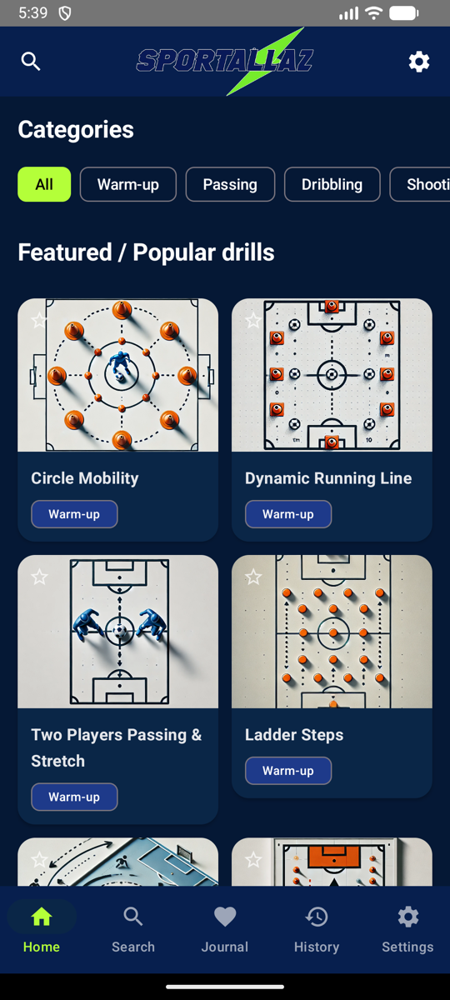
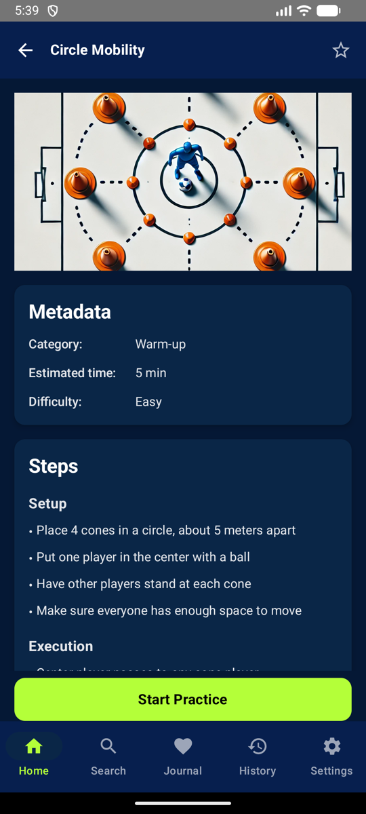
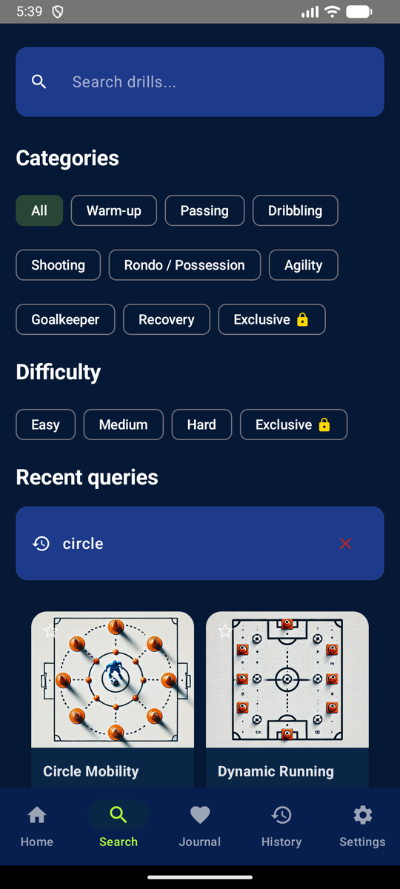

# SportallAZ

A football (soccer) training-drills catalog for coaches and players, built with **Kotlin Multiplatform** and **Compose Multiplatform**. The UI and all business logic live in shared code; Android and iOS are configured as targets.

<p>
  
  
  
</p>

## Features

- Catalog of 50 drills across 9 categories (Warm-up, Passing, Dribbling, Rondo, Shooting, Agility, Goalkeeper, Team Games, Recovery) and 3 difficulty levels
- Drill details: setup, execution, coaching points, estimated time, illustration
- Search by name and by step text, filters by category and difficulty, recent search queries
- Favorites ("Journal" tab)
- Practice mode with a timer, followed by an optional star rating
- History of completed drills and statistics (total, average rating, drills per category, most used drills) for all time, 7 days or 30 days
- Onboarding, settings, data export and data wipe
- Locked "exclusive" content behind a paywall screen. Purchases are simulated: unlock flags are stored in preferences, there is no real billing integration

## Architecture

The shared module follows a layered, MVVM-style structure with dependencies pointing inwards:

```
ui (Compose screens + ViewModels)
  -> domain/usecases (one class per action, e.g. SearchDrillsUseCase, GetStatisticsUseCase)
    -> repositories (interfaces + Default* implementations)
      -> sources (LocalDataSource: reads the bundled drills.json)
```

- **Dependency injection:** Koin (`di/AppModule.kt`). Repositories are singletons, use cases and ViewModels are factories.
- **Navigation:** Voyager (navigator, tab navigator, transitions).
- **Async:** Kotlin coroutines and Flow, with a `DispatcherProvider` abstraction.
- **Data:** drills are loaded once from a bundled JSON file via `kotlinx.serialization` and cached in memory; user data (favorites, history, flags) is stored in platform preferences through `expect/actual`.
- **Platform code:** `PreferencesRepository` and `DispatcherProvider` have separate `androidMain` and `iosMain` implementations.

## Tech stack

Kotlin 2.2 · Compose Multiplatform · Koin · Voyager · kotlinx.serialization · kotlinx.coroutines · kotlinx.datetime · Gradle (Kotlin DSL, version catalog)

## Project structure

```
composeApp/src
  commonMain   shared UI, domain, repositories, models, resources (drills.json, images)
  androidMain  Android entry point and platform implementations
  iosMain      iOS entry point and platform implementations
  commonTest   unit tests
iosApp         iOS application shell (Xcode project)
```

## Build and run

Requirements: JDK 17+ and the Android SDK (Android Studio recommended).

```shell
# Android debug build
./gradlew :composeApp:assembleDebug

# Unit tests
./gradlew :composeApp:testDebugUnitTest
```

For iOS, open `iosApp` in Xcode and run it (macOS only). The Android build, the unit tests and the app on an Android emulator have been verified; the iOS target is configured but has not been verified on a device or simulator.

## Tests

Unit tests live in `composeApp/src/commonTest` and cover the drill repository (JSON parsing, search, filters, categories, caching) and the statistics use case (averages, per-category counts, ranking, time filters), using in-memory fakes instead of a mocking framework.
